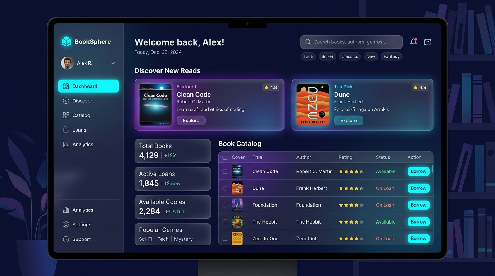

# BookSphere: Digital Library Management & Book Discovery System

A modern, high-performance library management and book discovery platform engineered with **Java 25 LTS**, **Spring Boot 3.5**, and **React.js 19**.



---

## 🌟 Key Highlights

- **Intelligent Book Discovery Engine:** Real-time reader satisfaction ranking, trending volumes, curated staff picks, and dynamic genre exploration powered by background indexing threads.
- **Unified Catalog for Physical & E-Books:** Handles print hardcover/paperbacks and digital media (PDF/EPUB) under a polymorphic object model.
- **Interactive Dual-Mode Operation:** 
  1. **React.js Web Interface:** Modern glassmorphism UI with real-time live preview for book covers, instant search, loan tracking, and CRUD modals.
  2. **Interactive Console CLI:** Robust terminal-based console menu with secure input validation, ANSI formatting, and zero external dependency runtime.
- **Resilient Multi-Tier Architecture:** Clean separation of concerns across `model`, `repository/DAO`, `service`, `util`, `menu`, and `controller`.
- **Dual Persistence Engines:** High-throughput pipe-delimited file storage (`data/backup.txt`, `data/logs.txt`) and production-ready relational SQL schemas (`sql/schema.sql`, `sql/sample_data.sql`).

---

## 📁 System Architecture

```text
BookSphere/
├── backend/
│   ├── src/main/java/com/booksphere/
│   │   ├── model/                 # LibraryItem (Abstract), Book, EBook, User, Member, BorrowRecord
│   │   ├── repository/            # BookDAO (Interface), BookRepositoryImpl, UserDAO
│   │   ├── service/               # BookService, DiscoveryService, BorrowService
│   │   ├── util/                  # DBConnection, FileManager, Validation, AsyncDiscoveryWorker
│   │   ├── menu/                  # Menu.java (Interactive Console CLI)
│   │   ├── exception/             # Custom exception classes
│   │   ├── controller/            # Spring Boot REST API (/api/books, /api/borrow)
│   │   ├── config/                # AppConfig (Dependency Injection) & WebConfig (CORS)
│   │   ├── BooksphereApplication.java # Spring Boot Web Application Main
│   │   └── Main.java              # Standalone Pure Core Java Console Main
│   ├── pom.xml                    # Maven configuration (Java 25, Spring Boot 3.5)
│   └── mvnw.cmd                   # Maven Wrapper
│
├── frontend/                      # React.js 19 + Vite Web Application
│   ├── src/
│   │   ├── App.jsx                # Discovery Feed, Catalog CRUD, Loans & Image Previews
│   │   ├── index.css              # Custom Theme & Micro-animations
│   │   └── main.jsx
│   ├── vite.config.js             # API Reverse Proxy
│   └── package.json
│
├── data/                          # Data storage
│   ├── backup.txt                 # Catalog records backup
│   └── logs.txt                   # Audit & activity logging
│
├── sql/                           # Relational Database scripts
│   ├── schema.sql                 # DDL Table schemas
│   └── sample_data.sql            # DML Seed catalog
│
├── documentation/                 # Technical documentation
│   └── JAVA_PROJECT_REVIEW_II_DOCUMENTATION.md
│
└── screenshots/                   # Mockups and Terminal Transcripts
    ├── booksphere_dashboard.jpg
    ├── booksphere_discovery_catalog.jpg
    └── console_demo_output.txt
```

---

## 🚀 Quick Start Guide

### Option 1: Full-Stack Web Application (Spring Boot + React)

#### 1. Launch Spring Boot Backend:
```powershell
cd backend
.\mvnw.cmd spring-boot:run
```
*API server will listen on port `8080` (Endpoint: `http://localhost:8080/api/books`).*

#### 2. Launch React Frontend:
```powershell
cd frontend
npm run dev
```
*Open [http://localhost:5173](http://localhost:5173) in your browser.*

---

### Option 2: Standalone Pure Core Java Console CLI

You can run the terminal console directly with pure Java without starting Spring Boot:
```powershell
cd backend

# Compile all classes
javac -d target/classes src/main/java/com/booksphere/model/*.java src/main/java/com/booksphere/repository/*.java src/main/java/com/booksphere/service/*.java src/main/java/com/booksphere/util/*.java src/main/java/com/booksphere/menu/*.java src/main/java/com/booksphere/exception/*.java src/main/java/com/booksphere/Main.java

# Run Console Menu
java -cp target/classes com.booksphere.Main
```

---

## 🎨 Features & Capabilities

1. **Book Discovery Feed:**
   - Highlights high-rated titles (rating ≥ 4.7★), curated staff picks, and genre tags.
   - Computes recommendations in background worker threads without UI lag.

2. **Digital Library Catalog (CRUD):**
   - **Add Records:** Add physical books and digital e-books with Title, Author, Category, ISBN, Year, Copies, Summary, and a **Book Cover Image URL with Live Thumbnail Preview & Preset Chips**.
   - **Search Records:** Fast case-insensitive keyword search across Title, Author, ISBN, Category, and Tags.
   - **Update Records:** In-place modification of details, stock counts, and cover images.
   - **Delete Records:** Safe removal of catalog records with confirmation prompts.
   - **View Switcher:** Toggle between modern Card Grid View and dense Table View.

3. **Loan Tracking & Returns:**
   - Real-time checkout and returns.
   - Automatic late fee calculation ($0.50/day for physical books, $0.15/day for e-books).

4. **Security & Input Sanitization:**
   - XSS and SQL injection token stripping in `Validation.java`.
   - Regular expression verification for ISBN and email formats.
